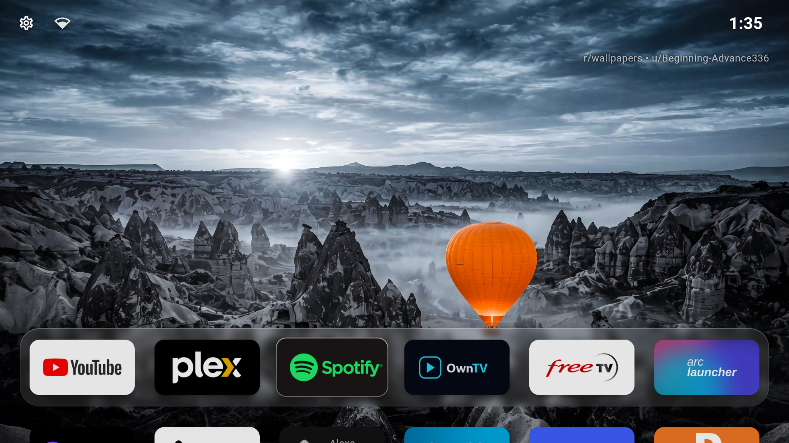
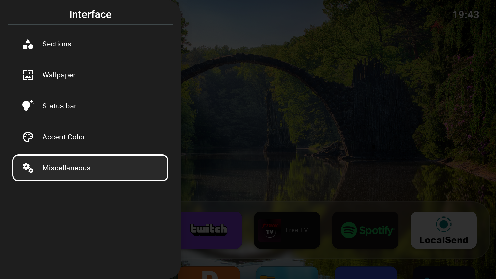
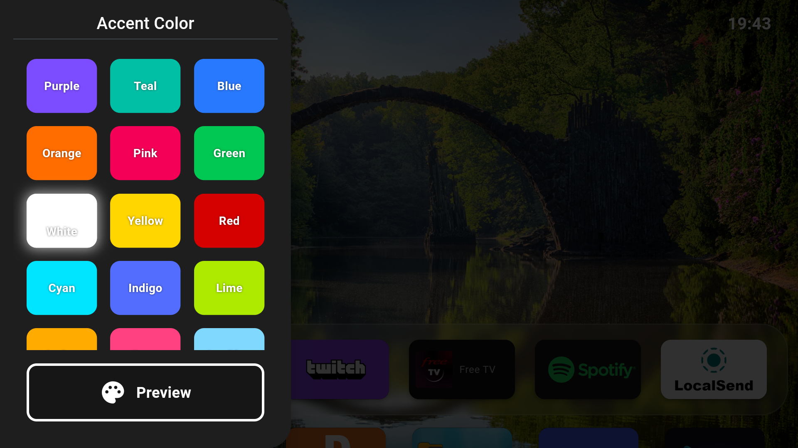
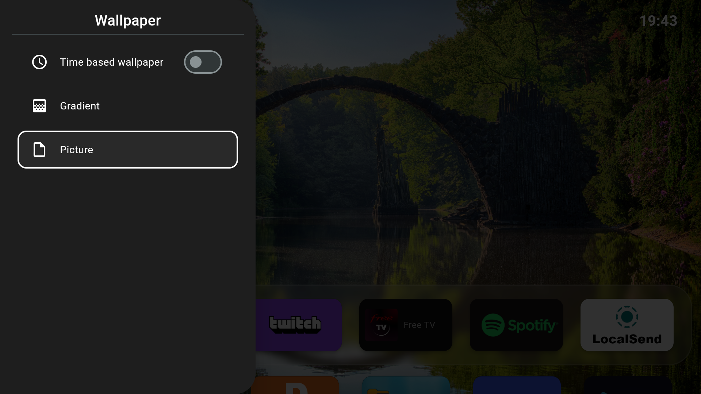
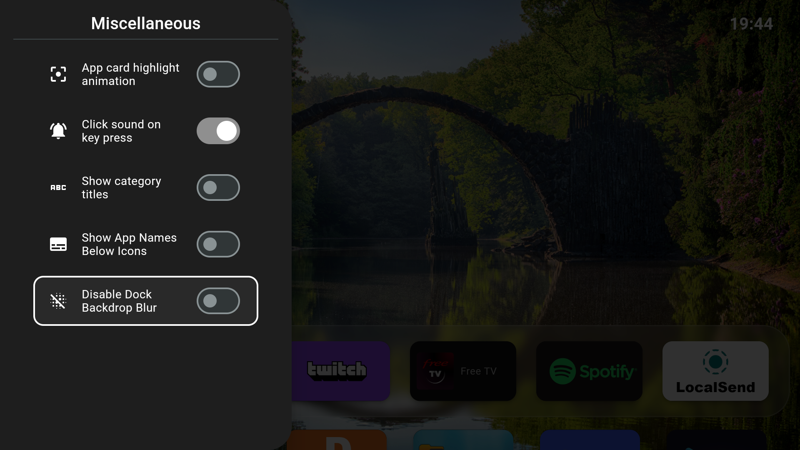
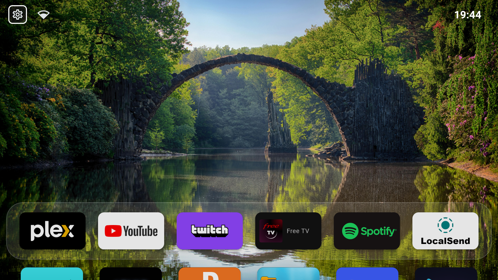
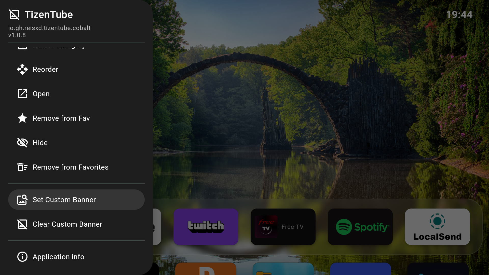
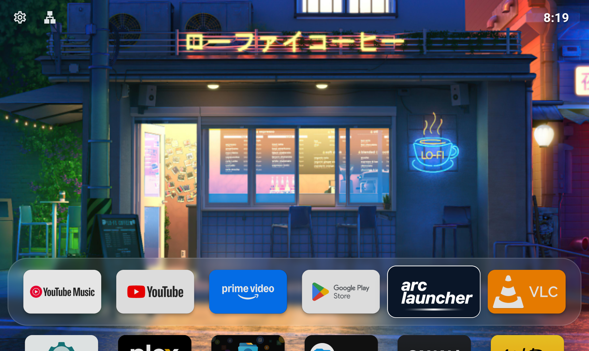
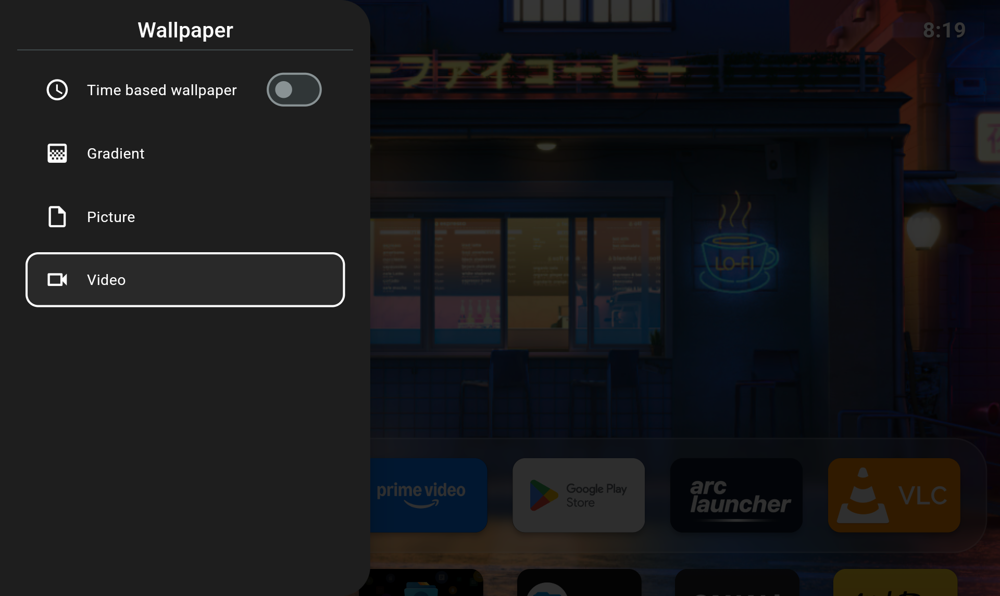
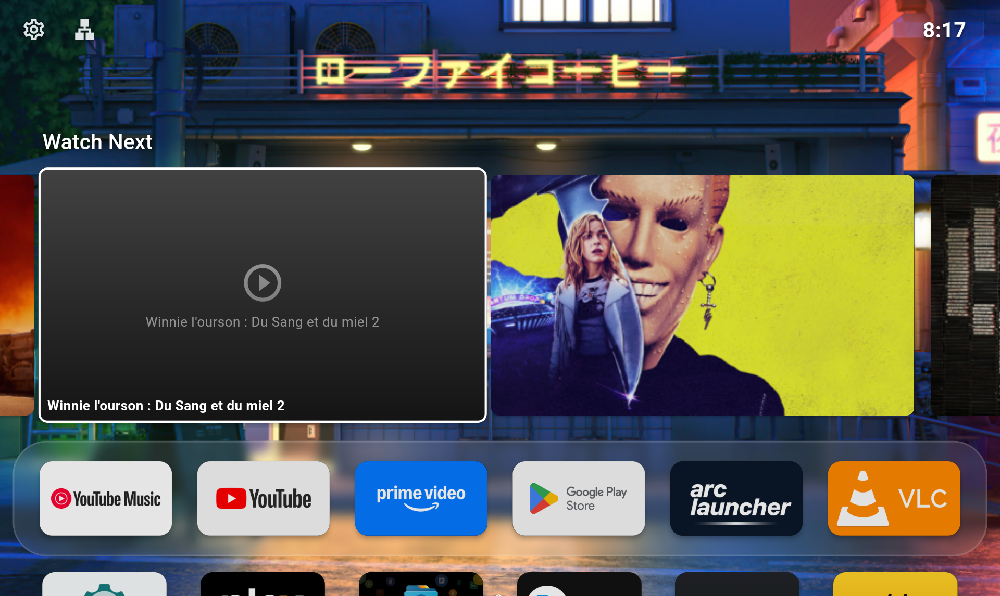

# Arc Launcher

<picture>
  
</picture>

[](https://github.com/meddouribadis/arclauncher/releases/latest) [](https://github.com/meddouribadis/arclauncher/releases) [](https://github.com/meddouribadis/arclauncher/stargazers)

**Arc Launcher** is a fork of [LTvLauncher](https://github.com/LeanBitLab/LtvLauncher) (originally by [etienn01](https://gitlab.com/flauncher/flauncher)) - an open-source alternative launcher for Android TV.

This customized version introduces a modern smart TV-style grid layout, usability enhancements, and UX improvements by [meddouribadis](https://github.com/meddouribadis).

<a href="https://github.com/meddouribadis/arclauncher/releases/latest">
  
</a>

### Downloader code: 6330120

## Join the Google Play Store beta

Arc Launcher is in closed beta on Google Play. To get early access to new builds and help shape what ships next,
join the beta group here with your Google Play email:

**[Arc Launcher Beta on Google Groups](https://groups.google.com/g/arc-launcher-beta/)**

Once you're in the group, you can enrol in the beta either way:

- **On the web** — open the [Google Play testing link](https://play.google.com/apps/testing/com.omeda.arc),
  sign in, and add the devices you want Arc on.
- **On Android** — follow the same testing link from the device itself, or find
  [Arc Launcher](https://play.google.com/store/apps/details?id=com.omeda.arc) in the Play Store app.

## Key Features & Enhancements

- **Modern TV Layout** - Redesigned home screen inspired by premium smart TV interfaces.
- **Data Usage Widget** - Track daily Internet consumption directly from the status bar.
- **Inbuilt OLED Screensaver** - Minimal screensaver with 30s clock position shifting to prevent burn-in.
- **Easy WiFi Access** - Network indicator doubles as a shortcut to system WiFi settings.
- **Quick Presets** - Select Time/Date formats and Category names from a list (No keyboard required).
- **Video Wallpaper** - Set animated video files as your home screen background for a dynamic visual experience.
- **Reddit Wallpaper Slideshow** - Rotate wallpapers from custom or default subreddits with configurable intervals (5 min to 24 hr), sort orders, and author credit display.
- **Unsplash Slideshow** - Rotate the wallpaper with random Unsplash photos (pick categories for day and night among Unsplash topics and a Milky Way collection; 5–60 min interval, cross-fade, photographer credit). Requires your own free Unsplash access key.
- **Dynamic & Time-Based Wallpaper** - Switch between day/night backgrounds or enable automatic dark mode based on time.
- **Watch Next Section** - Continue watching your shows with a dedicated "Watch Next" row at the top.
- **Hide Status Bar in Grid** - Automatically hide the status bar when scrolling into the app grid to free vertical screen space, restoring it when moving back to the dock.
- **Pitch Black Wallpaper** - A true black gradient background option for OLED optimization.
- **Enhanced Focus Indicator** - Double-border design ensures visibility on any background, with adjustable border thickness in Appearance settings.
- **Smart Navigation** - Fixed "bounce back" issues and optimized focus traversal for a smoother experience.
- **In-App Updater with Changelogs** - Check for updates and read release notes directly within the app.
- **Refined Settings** - Reorganized menus with a new "Miscellaneous" section and unified focus styles.
- **Accent Color Support** - Personalize the UI with multiple color presets.
- **Multilingual Support** - Interface available in English, Spanish, and Turkish.
- **Improved Sorting** - Easily reorder categories using Left/Right arrow keys instead of finicky gestures.
- **Left Side Settings** - Reorganized settings panel now opens on the left for better reach.
- **Brightness Scheduler (Experimental)** - Automatically adjust system brightness based on time of day (Requires `WRITE_SETTINGS` permission via ADB).
- **New Category** - Added "Favorites".
- **Custom Banner Support** - Display and apply your own personalized custom banners.
- **Optimizations** - Improved performance with aggressive icon caching and code cleanups.
- **Compatibility** - Works on Android TV boxes, Fire TV Stick, and other devices.

> [!WARNING]
> **Brightness Scheduler is an experimental feature.** It is currently untested across all devices and may be removed or modified in future versions based on user feedback.

> [!TIP]
> **Video Wallpaper Performance:** Using video wallpapers with the backdrop blur filter enabled may cause performance issues on older or low-powered devices. If you experience stuttering or lag, disable the backdrop filter in settings when using video backgrounds.

> [!TIP]
> **Video File Size:** Video wallpapers are loaded into RAM for smooth playback. For optimal performance, use small, compressed video files (ideally under 10MB) rather than large, high-bitrate videos.

> [!TIP]
> **Unsplash Slideshow:** create a free app at [unsplash.com/developers](https://unsplash.com/developers) and paste its *Access Key* in Settings → Interface → Wallpaper → Unsplash slideshow. Tick the categories to use by day and by night under *Categories*; one of them is picked at random for each photo. Demo keys allow 50 requests per hour; the slideshow uses at most 12. Only the two most recent photos are kept on disk.

> [!TIP]
> **Reddit Slideshow:** choose subreddits, sort orders, and intervals (5 minutes to 24 hours) under Settings → Wallpaper → Reddit. Works without an account using public feeds, with optional client credentials for authenticated access.

## Screenshots

<table>
  <tr>
    <td align="center">Settings panel</td>
    <td align="center">Accent colors</td>
    <td align="center">Multiple wallpapers</td>
  </tr>
  <tr>
    <td></td>
    <td></td>
    <td></td>
  </tr>
  <tr>
    <td align="center">Disable blur</td>
    <td align="center">Disabled blur</td>
    <td align="center">Custom banner</td>
  </tr>
  <tr>
    <td></td>
    <td></td>
    <td></td>
  </tr>
  <tr>
    <td align="center">Home</td>
    <td align="center">Wallpaper Options</td>
    <td align="center">Watch Next</td>
  </tr>
  <tr>
    <td></td>
    <td></td>
    <td></td>
  </tr>
</table>

## Original FLauncher Features

- [x] No ads
- [x] Customizable categories
- [x] Manually reorder apps within categories
- [x] Wallpaper support
- [x] Open "Android Settings"
- [x] Open "App info"
- [x] Uninstall app
- [x] Clock
- [x] Switch between row and grid for categories
- [x] Support for non-TV (sideloaded) apps
- [x] Navigation sound feedback

## Set Arc Launcher as default launcher

### Method 1: Remap the Home button

This is the "safer" and easiest way. Use [Button Mapper](https://play.google.com/store/apps/details?id=flar2.homebutton) to remap the Home button of the remote to launch Arc Launcher.

### Method 2: Set Arc as the home activity over ADB

This is the recommended way to make Arc Launcher your actual home screen. It is a single command, it leaves the
stock launcher untouched, and it can be undone just as easily.

```shell
$ adb shell cmd package set-home-activity com.omeda.arc/.MainActivity
```

This assigns Arc to the system `HOME` role, so the Home button on the remote goes straight to Arc. Nothing gets
disabled, which means nothing needs to be re-enabled if you change your mind.

To check which launcher is currently set as home:

```shell
$ adb shell cmd package resolve-activity -c android.intent.category.HOME -a android.intent.action.MAIN
```

To go back to the stock launcher, point the home activity at it instead. List the launchers installed on the
box and copy the one you want back straight from the output:

```shell
$ adb shell cmd package query-activities -c android.intent.category.HOME -a android.intent.action.MAIN
```

```shell
$ adb shell cmd package set-home-activity <package>/<activity>
```

> [!NOTE]
> `set-home-activity` requires Android 8.1 or newer, and what it accepts differs by version. On Android 10 and
> above it assigns the `HOME` role through `RoleManager` and the package name alone is enough. On Android 8.1 to
> 9 it sets a preferred activity directly and needs the full `<package>/<activity>` form. On older systems, use
> Method 1 or the fallback below.

> [!TIP]
> On Android 15 and newer you can also clear the assignment entirely with
> `adb shell cmd package clear-package-preferred-activities`, which makes the system ask again on the next
> Home press.

### Method 3: TV Box Tools (no command line)

TV Box Tools is a third-party tool that does the Method 2 setup without you typing any commands. Pick Arc
Launcher in the tool, and it installs the latest release if it isn't on the box yet and sets it as the home
activity. It runs on Windows, macOS, Linux, on a phone, or directly in a browser on the TV itself.

- [Google Play](https://play.google.com/store/apps/details?id=com.tv.launcher.manager.adb.tvboxtools)
- [tvboxtools.com](https://tvboxtools.com)

TV Box Tools is not affiliated with or endorsed by this project. As with any tool that administers your device,
review what it asks for before you run it — in particular whether it requires enabling wireless debugging on the
box, which exposes a debugging interface on your network.

### Fallback: Disable the default launcher

Use this only if Methods 2 and 3 do not work on your device. It is more invasive: it disables the stock
launcher, and it is the cause of the "YouTube" remote button issue described below.

> [!WARNING]
> **Disclaimer:** You are doing this at your own risk, and you'll be responsible in any case of malfunction on your device. The following commands have been tested on Chromecast with Google TV only and may differ on other devices.

Once the default launcher is disabled, press the Home button on the remote, and you'll be prompted by the system to choose which app to set as default.

#### Disable default launcher

```shell
# Disable com.google.android.apps.tv.launcherx which is the default launcher on CCwGTV
$ adb shell pm disable-user --user 0 com.google.android.apps.tv.launcherx
# com.google.android.tungsten.setupwraith will then be used as a 'fallback' and will automatically
# re-enable the default launcher, so disable it as well
$ adb shell pm disable-user --user 0 com.google.android.tungsten.setupwraith
```

#### Re-enable default launcher

```shell
$ adb shell pm enable com.google.android.apps.tv.launcherx
$ adb shell pm enable com.google.android.tungsten.setupwraith
```

#### Known issues

On Chromecast with Google TV (maybe others), the "YouTube" remote button will stop working if the default launcher is disabled. As a workaround, you can use [Button Mapper](https://play.google.com/store/apps/details?id=flar2.homebutton) to remap it correctly.

## Wallpaper

Because Android's `WallpaperManager` is not available on some Android TV devices, Arc Launcher implements its own wallpaper management method.

Please note that changing wallpaper requires a file explorer to be installed on the device in order to pick a file.

## Credits and contributors

<a href="https://github.com/meddouribadis/arclauncher/graphs/contributors">
  
</a>

### Original Projects

- **[FLauncher](https://gitlab.com/flauncher/flauncher)** by [etienn01](https://github.com/etienn01) - The original project
- **[FLauncher (Fork)](https://github.com/osrosal/flauncher)** by [osrosal](https://github.com/osrosal) - Community fork with additional features
- **[LTvLauncher](https://github.com/LeanBitLab/LtvLauncher)** by [LeanBitLab](https://github.com/LeanBitLab) - The base for this fork
- **[Arc Launcher](https://github.com/meddouribadis/arclauncher)** by [meddouribadis](https://github.com/meddouribadis)

---
